# Codebase Blueprint & Structural Graph

<!-- AUTO:BEGIN — regenerated by sync-architecture.sh. Do not edit. -->
## 1. High-Level Design (HLD) Topology

```mermaid
graph TD
    Client["Consumer / Client"] -->|Egress| API_Gateway["Gateway / Routing Layer"]
    subgraph FrontendLayer["Component & Router Architecture (JS/TS)"]
    App_Components["App Components"]
    UI_Stack["Design System: framer-motion tailwindcss @radix-ui lucide-react next react"] -.-> App_Components
    API_Gateway -->|Renders| Route__legal_["[legal]"]
    API_Gateway -->|Renders| Route_admin["admin"]
    API_Gateway -->|Renders| Route_admin_access_denied["admin-access-denied"]
    API_Gateway -->|Renders| Route_blog__slug_["blog/[slug]"]
    API_Gateway -->|Renders| Route_blog["blog"]
    API_Gateway -->|Renders| Route_contact["contact"]
    API_Gateway -->|Renders| Route_courses__slug_["courses/[slug]"]
    API_Gateway -->|Renders| Route_courses["courses"]
    API_Gateway -->|Renders| Route__["/"]
    API_Gateway -->|Renders| Route_privacy["privacy"]
    API_Gateway -->|Renders| Route_projects__slug_["projects/[slug]"]
    API_Gateway -->|Renders| Route_projects["projects"]
    API_Gateway -->|Renders| Route_snippets["snippets"]
    App_Components -.->|imports| about_section["about-section"]
    App_Components -.->|imports| activity_chart["activity-chart"]
    App_Components -.->|imports| admin_dashboard["admin-dashboard"]
    App_Components -.->|imports| admin_layout["admin-layout"]
    App_Components -.->|imports| alert_dialog["alert-dialog"]
    App_Components -.->|imports| animated_counter["animated-counter"]
    App_Components -.->|imports| back_to_top["back-to-top"]
    App_Components -.->|imports| backup_manager["backup-manager"]
    App_Components -.->|imports| badge["badge"]
    App_Components -.->|imports| blog_ideas_manager["blog-ideas-manager"]
    App_Components -.->|imports| blog_manager["blog-manager"]
    App_Components -.->|imports| breadcrumbs["breadcrumbs"]
    App_Components -.->|imports| button["button"]
    App_Components -.->|imports| card["card"]
    App_Components -.->|imports| cards["cards"]
    end
    subgraph Infra["Container Infrastructure"]
    Dockerfile_img["Dockerfile image"]
    end
```


## 2. Current Target Directory Tree
```text
.
 design
  fixtures
  proposals
   p1-signal
   p2-blueprint
   p3-quiet
 docs
  master
  project
   agent
   prompts
 prisma
  migrations
   20260627213813_init
 public
 scripts
 src
  app
   [legal]
   admin
   admin-access-denied
   api
   blog
   contact
   courses
   privacy
   projects
   snippets
  components
   admin
   site
   ui
  hooks
  lib
 supabase
  migrations
```
<!-- AUTO:END -->

## 3. Low-Level Design (LLD) & SOLID Class Schemas
- **Primary Interfaces:**
- **Cross-Service Communication:**
- **Data Inversion Maps:**

_Edit .project-architecture.manual.md; it is preserved across regenerations._
