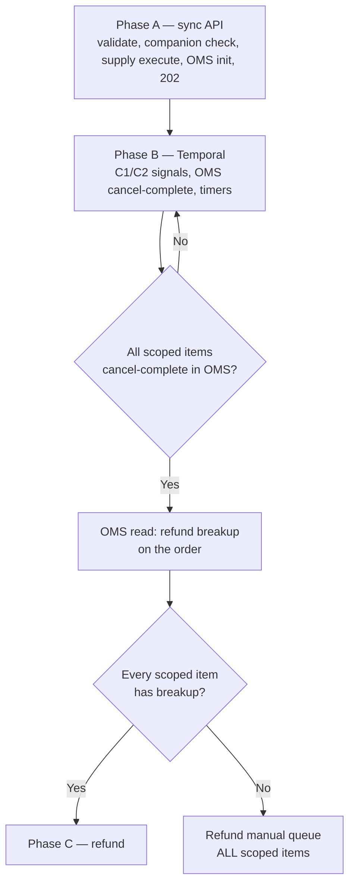
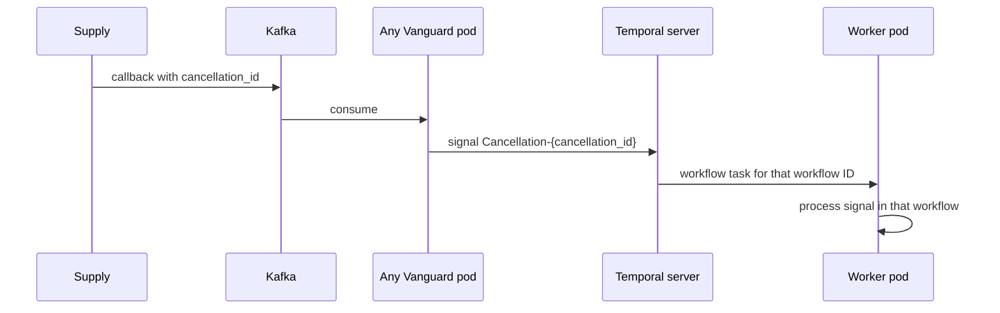
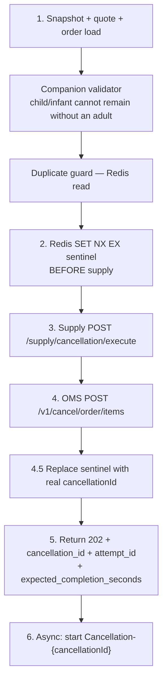
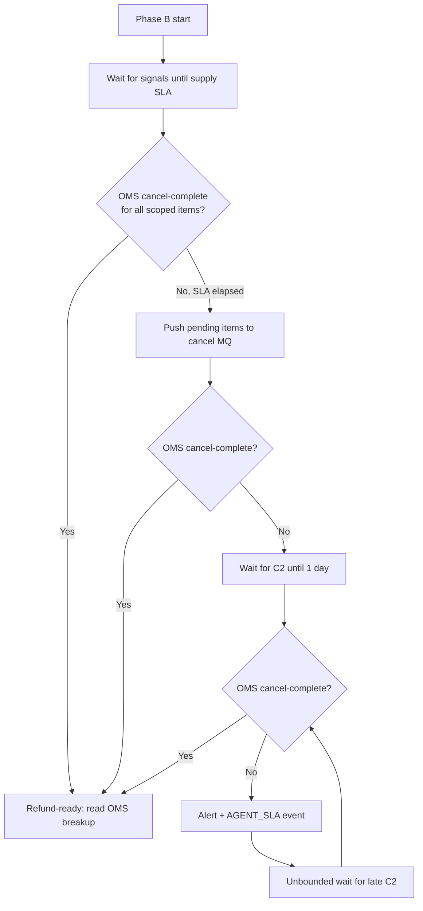

# Cancellation — Temporal Workflow

**Service:** Vanguard post-booking  
**Scope:** STS + OMS trips  
**Source of truth:** current code (`CancellationSyncApiOrchestratorImpl`, `CancellationWorkflowImpl`)  
**Replaces:** `docs/cancellation-execute-temporal-solutioning.docx` (outdated)

This document describes the **implemented** execute → Temporal flow. Older Word diagrams (infinite Phase B wait, per-signal dump to refund MQ, `POST /v1/cancel/order/items/status`, Penalty-Ready quote after the gate) are **not** current.

---

## 1. Overview

### 1.1 Purpose

- One long-running Temporal workflow per OMS cancel order: Phase B (cancel callbacks) + Phase C (refund).
- Replaces three legacy workflows (execute, refund-init, refund-execute).
- Targets STS + OMS trips.

### 1.2 Key design decisions

| Decision | Rationale |
|---|---|
| One workflow per `cancellationId` (OMS cancel-order id) | One order can have concurrent partial cancellations. Signals route by `cancellation_id`, not `order_id`. |
| `REJECT_DUPLICATE` reuse policy | Prevents duplicate starts for the same cancel order. |
| Redis `SET NX EX` in Phase A **before** supply | Prevents duplicate OMS/supply calls. Key = `orderId` + sorted supply item ids. |
| Signal queue (`ArrayDeque`) | Signals arriving while an activity runs are buffered and drained in order. |
| OMS as source of truth for both gates | Cancel-complete and refund-breakup are OMS reads, not workflow memory. |
| Async workflow start after `202` | HTTP returns before Temporal start. Redis handoff is the reconciliation net. |
| Persist breakup at OMS cancel-complete | Phase C can run from OMS/trips independently of workflow memory. |
| Refund is one-shot for the whole cancellation | If **any** scoped item lacks breakup after all are cancel-complete, **all** items go to refund MQ. |

### 1.3 Workflow settings

| Setting | Value |
|---|---|
| Workflow ID | `Cancellation-{cancellationId}` |
| Task queue | `CANCELLATION_TASK_QUEUE` |
| Reuse policy | `WORKFLOW_ID_REUSE_POLICY_REJECT_DUPLICATE` |
| Supply wait | `expected_completion_ms` from supply execute ACK (fallback 1800 s) |
| Agent wait | 1 day after cancel-MQ escalation (`manual-queue-wait-timeout: PT24H`) |
| Completes when | Phase C succeeds, entire cancellation is pushed to refund MQ, or agent external manual resolution covers the scope (no Phase C) |
| Activity timeout | `startToCloseTimeout` 2 min; max 3 attempts; exponential backoff 1 s → 5 min |

---

## 2. Architecture

### 2.1 Three-phase flow

- **Phase A:** synchronous API — validate, supply execute, OMS init, return 202, async workflow start.
- **Phase B:** Temporal — C1/C2 signals, persist cancel-complete (and breakup) to OMS, two timers.
- **Refund-ready check:** after the cancel-complete gate, **read OMS** for breakup. Not a second quote.
- **Phase C:** refund (Kraken or PROCESS). Only if every scoped item has breakup in OMS.

### 2.2 Multi-pod signal routing

Many Vanguard pods poll the same Temporal queue. That does **not** choose which workflow gets a callback.

| Question | Answer |
|---|---|
| Same pod required? | No. Temporal coordinates. |
| Who owns workflow state? | Temporal (durable history + signals). |
| What does the Kafka pod do? | `signalWorkflow(Cancellation-{cancellationId}, …)` |
| What does the worker do? | Polls `CANCELLATION_TASK_QUEUE` and runs **that** workflow's next decision. |

Routing key is **`cancellation_id` on the callback**, mapped to workflow ID `Cancellation-{cancellationId}`.

Inside the workflow, a second filter: `orderId` must match, and item ids must be in `scopedItemIds`. Out-of-scope items are dropped.

**Contract gap:** Vanguard's Kafka model **requires** `cancellation_id`. Supply execute currently does **not** send `cancellation_id`, so supply must still include OMS cancel-order id on the callback. Without it, the signal cannot be routed.

---

## 3. Phase A — Synchronous API

`POST /orders/{orderId}/cancellation` runs steps 1–4 on the request thread, returns **202 PROCESSING**, then starts the workflow asynchronously.

### 3.1 Step sequence

| Step | Action | On success | On failure |
|---|---|---|---|
| 1 | Snapshot + refund quote + booking-completed items | Continue | 400 — stop |
| 1b | Unaccompanied-minor check per snapshot group | Continue | 400 — stop |
| 0 / 2 | Redis `SET NX EX` sentinel **before** supply | Continue | 409 with cached outcome |
| 3 | Supply cancel execute | Continue (all items `ACCEPTED`) | Delete Redis key; error to UI; retry allowed |
| 4 | OMS cancel init for **all** scoped items | Continue | Error to UI; **keep** Redis key; no workflow |
| 4.5 | Rewrite Redis handoff with real `cancellationId` | Continue | — |
| 5 | Return 202 + `cancellation_id` + `attempt_id` + SLA seconds | HTTP flushed | — |
| 6 | Async start `Cancellation-{cancellationId}` | Workflow in Phase B; delete Redis key | Retry + alert; UI already has 202 |

### 3.2 Supply execute ACK

Supply always ACKs every requested item as **ACCEPTED**. `REJECTED` is not returned on execute. E1 (push REJECTED ACK items to cancel MQ on workflow entry) is removed.

SLA: prefer `expected_completion_ms` per item; fall back to seconds. UI gets `expected_completion_seconds`. Workflow wait uses milliseconds (max across items; fallback 1800 s).

### 3.3 Duplicate handling

| Scenario | Behaviour |
|---|---|
| Same items, concurrent / retry while in flight | 409 + cached outcome |
| Different item subsets, same order | Allowed (item-set key) |
| Supply failed | Redis key deleted; retry allowed |
| OMS failed after supply succeeded | Redis key kept; retry blocked (would 400 at supply) |
| Workflow start confirmed | Redis key deleted; Temporal `REJECT_DUPLICATE` takes over |

### 3.4 Handoff payload (Phase A → Phase B)

| Field | Source | Purpose |
|---|---|---|
| `orderId` | API | OMS / trips |
| `attemptId` | `request_id` | Idempotency |
| `cancellationId` | OMS init | Workflow ID; cancel-complete GET |
| `scopedItemIds` | Execute scope (supply item ids) | Gate scope |
| `trackingId` | Order | Manual queue |
| `quoteSnapshotId` | Redis, if `quote_id` on request | Quote snapshot |
| `expectedCompletionMs` | Supply ACK SLA | Phase B supply timer |
| `agentWaitTimeoutMs` | 1 day | Phase B agent timer |
| `bookingType` | Order (TODO: not yet populated) | Phase C Kraken vs PROCESS |

### 3.5 OMS failure after supply — mitigations

Supply has accepted cancel, OMS has no record, no workflow:

1. **Implemented:** Redis sentinel before supply. Retry → 409, not a second supply execute.
2. **Ops:** on OMS fail after supply success, log + custom event `process=OMS_CANCEL_INIT` (Redis sentinel kept). Reconciliation job for orphaned keys is still TODO.

Callbacks for that cancel order have no workflow → logged and dropped (`CancellationWorkflowNotFoundException`).

---

## 4. Phase B — Cancel callbacks

The workflow does **not** wait infinitely for supply.

1. Wait for C1 until supply SLA.
2. Remaining items → **cancel** manual queue. Phase B continues.
3. Wait 1 day for agent C2.
4. On agent SLA miss: alert + `process=AGENT_SLA` event, then **keep waiting** for a late C2.

### 4.1 Signal contract

| Signal | Source | Transport | Status values | `resolution_type` | Behaviour |
|---|---|---|---|---|---|
| C1 | Supply | Kafka / Pulsar | `COMPLETED` or `FAILED` | absent | OMS complete / cancel MQ |
| C2 | air-cancel-flow | Kafka / REST → `onAgentCancellationUpdate` | `CANCEL_COMPLETE` | **required** | See §4.2 |

`PROCESSING`, `REJECTED`, `CANCEL_REFUNDED` are dropped if received in Phase B.

Callback payload **must** include `cancellation_id` (OMS cancel-order id).

C2 without `resolution_type` is **dropped** (not enqueued).

### 4.2 Per-signal handling

After draining the signal queue, every in-scope item is handled immediately.

**C1 `COMPLETED`**

- `completeOmsCancelledItems` → OMS cancel-complete **without** breakup. Penalty/breakup from supply status after the gate.

**C1 `FAILED`**

- `pushToCancelManualQueue` (E2). No OMS complete. Agent later sends C2.

**C2 `CANCEL_COMPLETE` + `resolution_type=AUTO_REFUND`**

- OMS cancel-complete without breakup (same as prior agent path). Continues toward Phase C when the scope is OMS-complete.

**C2 `CANCEL_COMPLETE` + external `resolution_type`**

External types (same path): `FULL_REFUND`, `FULL_REFUND_WITH_PG`, `MANUAL_INSTANT_REFUND`, `UPDATE_PNR`.

- **No** OMS cancel-complete.
- Item ids added to workflow set `externallyResolvedItemIds`.
- `process=MANUAL_EXTERNAL_RESOLUTION` event.

**Phase B done (hybrid gate)**

Every scoped item is either:

- OMS cancel-complete, **or**
- present in `externallyResolvedItemIds`

When done:

- If **any** item is externally resolved → skip Phase C; terminal state `COMPLETED_EXTERNAL_RESOLUTION`.
- Else → supply status / breakup / Phase C as before.

### 4.3 Example: i1 / i2 / i3

Assume scoped items `[i1, i2, i3]`.

| Event | Action | Gate | Next |
|---|---|---|---|
| i1 C1 COMPLETED | OMS complete without breakup | i2, i3 pending → wait | — |
| i2 C2 AUTO_REFUND | OMS complete without breakup | i3 pending → wait | — |
| i3 C2 AUTO_REFUND | OMS complete without breakup | All OMS complete | Supply status → Phase C or refund MQ |

External example: i2+i3 still pending in cancel MQ; agent sends C2 `FULL_REFUND` for both → no OMS complete; `externallyResolved={i2,i3}`; if i1 already OMS-complete → scope covered → skip Phase C → `COMPLETED_EXTERNAL_RESOLUTION`.

### 4.4 Cancel-complete gate (status)

| | |
|---|---|
| Question | Are the given remaining supply item ids cancel-complete in OMS under this `cancellationId`? |
| Activity | `fetchAndEvaluateCancelCompleteGate(orderId, cancellationId, supplyItemIds)` |
| When some external | Pass `scoped − externallyResolvedItemIds` |
| When all external | Remaining empty → gate passes in workflow without OMS |
| On pass with any external | Skip Phase C; `COMPLETED_EXTERNAL_RESOLUTION` |
| On pass with no external | Refund-ready supply status / breakup (§4.5) → Phase C or refund MQ |

There is **no** `POST /v1/cancel/order/items/status`.

### 4.5 Refund-ready check (breakup)

After the status gate passes **and** there are no externally resolved items:

1. Fetch supply status for scoped items.
2. If any scoped item lacks penalty breakup → refund MQ for **all** scoped items; no Phase C.
3. Else compute B2C breakup, OMS-complete with breakup, Phase C.

### 4.6 Manual queues

| Queue | Phase | Trigger | What is pushed | Resolver |
|---|---|---|---|---|
| Cancel MQ | B | C1 `FAILED`, or supply SLA with items still pending | Those pending / failed items | Agent → C2 with `resolution_type` |
| Refund MQ | After status gate (no external) | Any scoped item missing supply penalty breakup | **Entire** scoped set | Agent / refund ops |

Cancel-MQ push does **not** end Phase B. C2 is still processed.

### 4.7 Eventing

One Insights table: `POST_BOOKING_CANCELLATION_EVENTS`, segregated by `process`:

| `process` | When |
|---|---|
| `CANCEL_EXECUTE` | Execute / cancel-callback (reserved) |
| `OMS_CANCEL_INIT` | Supply execute succeeded, OMS cancel init failed (orphaned at supply) |
| `AGENT_SLA` | 1-day agent wait missed |
| `MANUAL_EXTERNAL_RESOLUTION` | Agent chose external resolution (full refund / PG / instant / update PNR) |
| `REFUND_BREAKUP` | OMS / supply missing breakup for listed items |
| `REFUND_MANUAL_QUEUE` | Whole cancellation sent to refund MQ |

---

## 5. Phase C — Refund

Entered only when every scoped item is OMS cancel-complete, **none** are externally resolved, **and** supply status has penalty breakup for all scoped items.

### 5.1 Booking-type routing

| Booking type | Path | On failure |
|---|---|---|
| `FLIPKART_ULTRA` | Kraken initiate refund (activity, up to 3 Temporal retries) | Fall through to PROCESS |
| `CLEARTRIP` / null | PROCESS | See below |

`bookingType` on the handoff is not yet populated from order context (TODO). Null is treated as PROCESS.

### 5.2 PROCESS path

| Step | Activity | Detail | On failure |
|---|---|---|---|
| C.1 | `submitRefundSanityChecks` | Redis lock 120 s; payments exist; no existing `refundId` | `REFUND_FAILED` |
| C.2 | `getOrCreateRefundTransaction` | Trip `PUT /trips/txns` | Activity retry |
| C.3 | `executeRefundPayment` | Payment `POST /refund` | NR alert + `REFUND_FAILED` |
| C.4 | `markItemsBookingRefunded` | OMS `POST /v1/book/order/{orderId}/items/refund` | Activity retry |
| C.5 | `processVasClaims` | VAS / insurance if eligible | Activity retry |
| C.6 | `triggerInsurerMail` | EzCancel Plus email | Activity retry |
| C.7 | `disableWalletPromos` | Only if eligible | Activity retry |
| — | — | Workflow `COMPLETED` | — |

C.1 and C.3 are stubs pending Redis lock, payment, and trip wiring.

---

## 6. Item status rules

Defined in `CancellationItemStatusRules`.

| Status | Terminal | Cancel-complete | Phase B action |
|---|---|---|---|
| `COMPLETED` | Yes | Yes | OMS complete with inline breakup, or quote then OMS complete |
| `CANCEL_COMPLETE` | Yes | Yes | Quote then OMS complete |
| `FAILED` | Yes | No | Cancel MQ (E2) |
| `CANCEL_REFUNDED` | Yes | No | Dropped in Phase B (Phase C terminal) |

`CANCELLED` is treated as cancel-complete for the **OMS status gate** only.

---

## 7. OMS endpoints used

| When | Method | Path |
|---|---|---|
| Phase A init | `POST` | `/v1/cancel/order/items` |
| Phase B persist complete + breakup | `POST` | `/v1/cancel/order/items/complete` |
| Phase B cancel-complete gate | `GET` | `/v1/cancel/order/{cancelOrderId}` |
| Phase B refund-ready | `GET` | order / trips (OMS order fetch) |
| Phase C mark refunded | `POST` | `/v1/book/order/{orderId}/items/refund` |
| Phase C (optional) | `POST` | `/v1/cancel/refund` |

---

## 8. Known gaps (code vs full production)

| Gap | Impact |
|---|---|
| `RefundQuoteService` not wired | Quote activity OMS-completes the signal as-is and stubs “all items have breakup”. Real C2 breakup may be missing on the order until quote is implemented. |
| `cancellation_id` not sent on supply execute | Supply must still put OMS cancel-order id on the Kafka callback. |
| `bookingType` not set on handoff | Kraken path never selected until populated. |
| Phase C activities are stubs | Sanity checks, payment, trip txn, VAS, promo not live. |
| OMS-after-supply reconciliation job | Alert path for orphaned supply cancels is not fully wired. |

---

## 9. What changed vs the old Word doc

| Old doc | Current code |
|---|---|
| Infinite Phase B wait; 4h alert only | Supply SLA → cancel MQ; then 1-day agent wait; then alert and keep waiting |
| C2: no OMS complete at signal; quote at Penalty-Ready Gate | C2: quote then OMS complete **at signal time** |
| Missing breakup → push **those** items to refund MQ and/or kill workflow | Missing breakup recorded; wait until **all** cancel-complete; then **all** items to refund MQ |
| Quote once after gate | Quote at C1-without / C2; after gate **read OMS** |
| `POST /v1/cancel/order/items/status` | `GET /v1/cancel/order/{cancelOrderId}` |
| Task queue `cancellation-task-queue` | `CANCELLATION_TASK_QUEUE` |
| C2 status `COMPLETE` | `CANCEL_COMPLETE` |
| No companion check | Unaccompanied minor validation on execute |
| No `process` event table | `POST_BOOKING_CANCELLATION_EVENTS` + `PostBookingProcess` |
