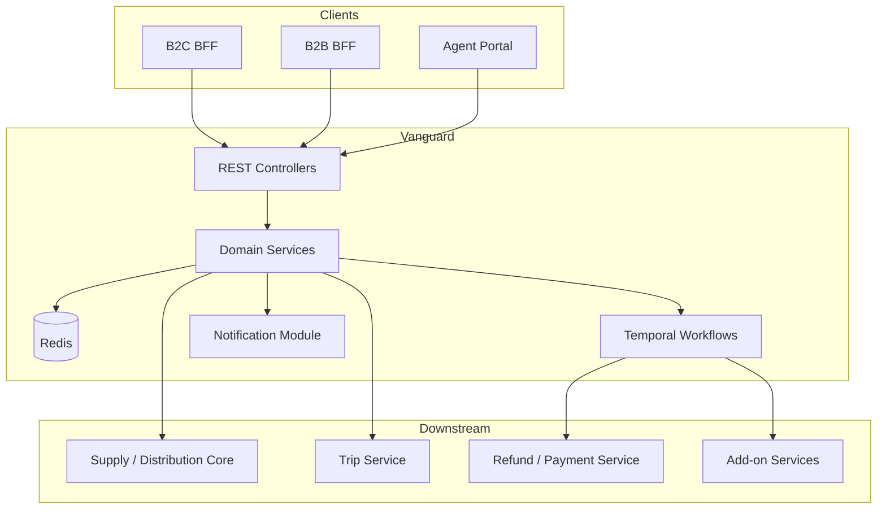
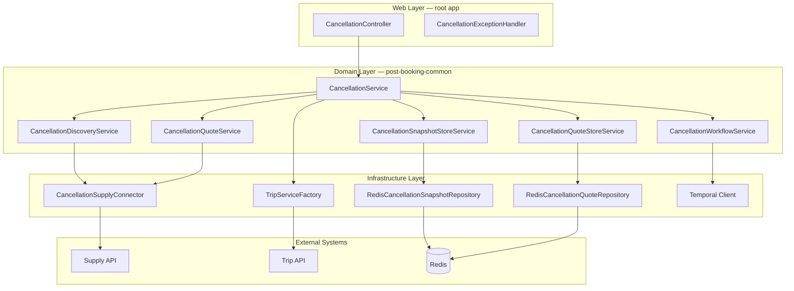

# LLD — Project Repository Initial Setup & Architecture

**Service:** Vanguard — Post-Booking Orchestration  
**Version:** 1.0  
**Source:** *Post booking cancellation flows* (Design Document)  
**Audience:** Engineering (Backend, Platform, QA)

---

## 1. Executive Summary & Tech Stack

### 1.1 Purpose

Vanguard is the **Demand-side post-booking orchestrator** for Cleartrip. It owns the lifecycle between user intent and supplier execution for:

- **Cancellation** (discovery → quote → execute → status → refund trigger)
- **Refund** (orchestration handoff to payment/refund service)
- **Amendment** (future; package scaffolded)

The service does **not** replace Supply (distribution core), Trip Service, or Payment/Refund Service. **Notification orchestration lives inside Vanguard** (internal module). Vanguard **orchestrates**, **persists ephemeral state** (snapshot/quote in Redis), and **enforces business rules** from the solutioning document.

### 1.2 Tech Stack

| Layer | Technology | Rationale |
|-------|------------|-----------|
| Language | **Java 21** | Records, pattern matching, virtual threads readiness |
| Framework | **Spring Boot 3.5.x** | REST, validation, actuator, DI |
| Build | **Gradle 8.x** (Groovy DSL) | Multi-module; Cleartrip CI plugins |
| HTTP clients | **Spring RestClient** | Supply + Trip integration |
| Ephemeral state | **Redis (Jedis)** | Snapshot (§6.5), Quote (§6.6) — TTL-based |
| Workflow | **Temporal** (recommended §5.14) | Async cancellation, callback signals, exactly-once refund gate |
| Messaging | **Kafka / Event Bus** (optional fan-out) | Refund trigger, notifications, audit — integrate with platform bus |
| Observability | **Actuator, New Relic, distributed tracing** | §3.7 — demand → supply → refund trace |
| Quality | **Spotless, Checkstyle, JaCoCo, SonarQube** | Enterprise CI gates |

### 1.3 High-Level System Context



---

## 2. Directory & Module Structure

### 2.1 Gradle Multi-Module Layout

```
vanguard/
├── build.gradle                 # Root Spring Boot app (bootJar → vanguard.jar)
├── settings.gradle              # include 'models', 'post-booking-common'
├── Dockerfile
├── src/main/java/               # HTTP layer only (thin)
├── src/main/resources/
├── models/                      # Shared immutable domain models (Lombok @Value / Records)
└── post-booking-common/         # All business logic, connectors, repositories
```

**Dependency direction (strict):**

```
root-app  →  post-booking-common  →  models
```

Root app must **not** contain business logic beyond controllers, global exception handling, and application bootstrap.

### 2.2 Package Tree (ASCII)

```
com.cleartrip.postbooking
│
├── PostBookingOrchestrationApplication.java     [root module]
│
├── common/                                      [root module — cross-cutting HTTP]
│   ├── HealthController.java
│   └── CancellationExceptionHandler.java        @RestControllerAdvice
│
├── cancellation/                                [root module — REST only]
│   └── controller/
│       ├── CancellationController.java          discovery | quote | execute | status
│       └── dto/
│           ├── DiscoverCancellationRequest.java
│           ├── CancellationQuoteRequest.java
│           └── CancellationExecuteRequest.java
│
└── post-booking-common/
    │
    ├── config/
    │   └── redis/
    │       └── RedisConfiguration.java
    │
    ├── cache/
    │   ├── Cache.java
    │   └── impl/JedisCacheImpl.java
    │
    ├── supply/                                  [shared Supply HTTP — all flows]
    │   └── connector/
    │       ├── SupplyRestClientFactory.java
    │       ├── SupplyConnectorException.java
    │       └── config/
    │           ├── SupplyClientProperties.java
    │           ├── CancellationFlowEndpoints.java
    │           ├── RefundFlowEndpoints.java      (reserved)
    │           └── AmendFlowEndpoints.java       (reserved)
    │
    ├── trip/                                    [Trip load — legacy + new]
    │   ├── config/TripServiceProperties.java
    │   ├── connector/                           HTTP to Trip Service
    │   ├── adapter/                             Raw trip → TripBookingContext
    │   └── service/
    │       ├── TripService.java                 interface
    │       ├── TripServiceFactory.java
    │       └── impl/
    │           ├── LegacyTripServiceImpl.java
    │           └── NewTripServiceImpl.java
    │
    ├── cancellation/                            [Cancellation domain]
    │   ├── controller/                          (none — lives in root app)
    │   ├── service/
    │   │   ├── CancellationService.java         lifecycle orchestrator (interface)
    │   │   ├── CancellationDiscoveryService.java
    │   │   ├── CancellationQuoteService.java
    │   │   └── impl/
    │   │       ├── CancellationServiceImpl.java
    │   │       ├── CancellationDiscoveryServiceImpl.java
    │   │       └── CancellationQuoteServiceImpl.java
    │   ├── connector/
    │   │   └── CancellationSupplyConnector.java
    │   ├── mapper/                              supply DTO ↔ domain
    │   ├── adapter/                             core + UI response assembly
    │   │   ├── CoreCancellationResponseAdapter.java
    │   │   └── ui/                              (placeholder — UI models TBD)
    │   ├── snapshot/
    │   │   ├── config/CancellationSnapshotProperties.java
    │   │   ├── mapper/CancellationSnapshotMapper.java
    │   │   ├── repository/
    │   │   │   ├── CancellationSnapshotRepository.java
    │   │   │   └── RedisCancellationSnapshotRepository.java
    │   │   ├── service/
    │   │   │   ├── CancellationSnapshotStoreService.java
    │   │   │   └── impl/CancellationSnapshotStoreServiceImpl.java
    │   │   └── exception/
    │   ├── quote/                               (mirror snapshot for §6.6)
    │   │   ├── repository/
    │   │   ├── mapper/
    │   │   └── service/
    │   ├── workflow/                            Temporal workflows + activities (TBD)
    │   └── supply/dto/                          wire-format request/response
    │
    ├── refund/                                  [Refund domain — scaffold]
    │   └── package-info.java
    │
    └── amendment/                               [Amendment domain — scaffold]
        └── package-info.java
```

### 2.3 Module Responsibilities

| Module | Contains | Must NOT contain |
|--------|----------|------------------|
| **models** | Domain value objects, snapshot/quote Redis payloads, enums | Spring annotations (except validation), HTTP, DB clients |
| **post-booking-common** | Services, connectors, mappers, Redis repos, workflow | `@RestController`, `@RequestMapping` |
| **root app** | Controllers, `application.yaml`, global exception handler | Direct repository/connector calls, domain mapping |

---

## 3. Layer Boundaries & Package Rules

### 3.1 Layer Diagram



### 3.2 Core Architectural Rules

1. **Controllers are thin.** Validate input, delegate to `CancellationService`, map HTTP status. No business branching.

2. **Single domain orchestrator per flow.** `CancellationService` owns discovery → quote → execute → status. Sub-services (`CancellationDiscoveryService`, `CancellationQuoteService`) wrap single downstream calls.

3. **Interface + `impl` package.** Every service exposed for injection has an interface in `service/` and implementation in `service/impl/`.

4. **Constructor injection only.** All Spring beans use `@RequiredArgsConstructor` + `final` fields. No field `@Autowired`.

5. **Connectors ≠ Services ≠ Repositories.**
   - **Connector** — HTTP/RPC to external system (Supply, Trip).
   - **Service** — business orchestration and validation.
   - **Repository** — Redis/DB persistence port.

6. **Redis stores mappings + money, not UI.** Snapshot (§6.5) and Quote (§6.6) payloads exclude labels, display names, and presentation copy. UI responses are assembled at read time from Trip + Order + Redis.

7. **Supply is source of truth** for cancellation groups, penalties, and item-level outcomes. Demand never re-derives grouping logic.

8. **Trip Service is source of truth** for pax, segment display, and order presentation data.

9. **Workflow owns async state.** Item-level terminal gates, callback ordering, and refund trigger preconditions live in Temporal (§5.14), not in controller request threads.

10. **Idempotency everywhere async.**
    - `cancellation_id` correlates execute → callback → status.
    - `quote_id` binds execute to quoted penalties.
    - `snapshot_id` binds quote/execute to discovery mappings.
    - Redis / workflow dedup for duplicate callbacks.

11. **Stateless services.** No mutable instance state on `@Service` beans. Ephemeral state only in Redis with TTL.

12. **Records for wire DTOs.** Immutable request/response records in controller and supply DTO packages.

13. **Domain models use Lombok `@Value @Builder`** in `models` module (Java records optional where team convention allows).

14. **No controller → repository** shortcuts. Always through service layer.

15. **Extensibility by package mirror.** `refund/` and `amendment/` follow same layout as `cancellation/` when implemented.

---

## 4. Bootstrap & Configuration

### 4.1 Application Entry

```java
@SpringBootApplication(scanBasePackages = "com.cleartrip.postbooking")
public class PostBookingOrchestrationApplication {
  public static void main(String[] args) {
    SpringApplication.run(PostBookingOrchestrationApplication.class, args);
  }
}
```

### 4.2 Configuration Properties (Representative)

```yaml
post-booking:
  trip:
    version: LEGACY
    legacy:
      base-url: http://trip-service/trip
  supply-client:
    cancellation:
      discovery: { path: /supply/cancellation/capability, ... }
      quote:     { path: /supply/cancellation/quote, ... }
      execute:   { path: /supply/cancellation/execute, ... }
      status:    { path: /supply/cancellation/{cancellationId}, ... }
  cancellation:
    snapshot:
      ttl-seconds: 3600
      key-prefix: "cancellation:snapshot:mapping:"
    quote:
      ttl-seconds: 1800
      key-prefix: "cancellation:quote:mapping:"

ct:
  itin:
    redis:
      hostname: localhost
      port: 6379
```

### 4.3 Representative Controller (Thin)

```java
@RestController
@RequestMapping("/orders/{orderId}/cancellation")
@RequiredArgsConstructor
@Validated
public class CancellationController {

  private final CancellationService cancellationService;

  @PostMapping("/discover")
  public ResponseEntity<CancellationDiscoveryResponse> discover(
      @PathVariable @NotBlank String orderId,
      @Valid @RequestBody DiscoverCancellationRequest request) {
    return ResponseEntity.ok(
        cancellationService.discover(orderId, request.supplyItemIds()));
  }

  @PostMapping("/quote")
  public ResponseEntity<CancellationQuoteOutcome> quote(
      @PathVariable @NotBlank String orderId,
      @Valid @RequestBody CancellationQuoteRequest request) {
    return ResponseEntity.ok(cancellationService.quote(orderId, request));
  }

  @PostMapping
  public ResponseEntity<CancellationExecuteOutcome> execute(
      @PathVariable @NotBlank String orderId,
      @Valid @RequestBody CancellationExecuteRequest request) {
    return ResponseEntity.accepted().body(cancellationService.execute(orderId, request));
  }

  @GetMapping("/{cancellationId}")
  public ResponseEntity<CancellationStatusOutcome> status(
      @PathVariable @NotBlank String orderId,
      @PathVariable @NotBlank String cancellationId) {
    return ResponseEntity.ok(cancellationService.getStatus(orderId, cancellationId));
  }
}
```

### 4.4 Representative Service Orchestrator

```java
@Service
@RequiredArgsConstructor
@Validated
public class CancellationServiceImpl implements CancellationService {

  private final CancellationDiscoveryService discoveryService;
  private final CancellationQuoteService quoteService;
  private final CancellationSnapshotStoreService snapshotStore;
  private final CancellationQuoteStoreService quoteStore;
  private final TripServiceFactory tripServiceFactory;
  private final CoreCancellationResponseAdapter coreAdapter;
  private final CancellationWorkflowService workflowService;

  @Override
  public CancellationDiscoveryResponse discover(String orderId, List<String> supplyItemIds) {
    var supplyResponse = discoveryService.discover(supplyItemIds);
    var tripContext = tripServiceFactory.getActive().fetchByOrderId(orderId);
    var snapshot = snapshotStore.saveFromSupplyResponse(orderId, supplyResponse);
    var core = coreAdapter.toCoreResponse(orderId, supplyResponse, tripContext, snapshot.getSnapshotId());
    return CancellationDiscoveryResponse.builder()
        .snapshotId(snapshot.getSnapshotId())
        .coreResponse(core)
        .build();
  }

  // quote, execute, status — delegate to sub-services + workflow
}
```

### 4.5 Representative Record DTO

```java
public record DiscoverCancellationRequest(
    @NotEmpty List<@NotBlank String> supplyItemIds) {}
```

### 4.6 Exception Handling

```java
@RestControllerAdvice
public class CancellationExceptionHandler {

  @ExceptionHandler(SnapshotNotFoundException.class)
  public ResponseEntity<ErrorBody> snapshotNotFound(SnapshotNotFoundException ex) {
    return ResponseEntity.status(HttpStatus.GONE).body(ErrorBody.of("SNAPSHOT_NOT_FOUND", ex.getMessage()));
  }

  @ExceptionHandler(SnapshotExpiredException.class)
  public ResponseEntity<ErrorBody> snapshotExpired(SnapshotExpiredException ex) {
    return ResponseEntity.status(HttpStatus.GONE).body(ErrorBody.of("SNAPSHOT_EXPIRED", ex.getMessage()));
  }
}
```

---

## 5. Redis Entity Contracts (Persisted State)

| Entity | Section | Key pattern | TTL | Contents |
|--------|---------|-------------|-----|----------|
| Snapshot | §6.5 | `cancellation:snapshot:mapping:{snapshotId}` | ~1h | `group_id → item_ids`, `pax_ids`, dependencies |
| Quote | §6.6 | `cancellation:quote:mapping:{quoteId}` | ~30m | Group penalties, `penalty_by_items`, summary, override amounts |
| Cancellation | §6.7 | DB / workflow state | — | `cancellation_id`, override audit (durable) |

---

## 6. API Surface (Demand → UI / BFF)

| Method | Path | Service method | Sync/Async |
|--------|------|----------------|------------|
| `POST` | `/orders/{orderId}/cancellation/discover` | `discover` | Sync |
| `POST` | `/orders/{orderId}/cancellation/quote` | `quote` | Sync |
| `POST` | `/orders/{orderId}/cancellation` | `execute` | Async ACK (202) |
| `GET` | `/orders/{orderId}/cancellation/{cancellationId}` | `getStatus` | Sync |
| `POST` | `/internal/supply/cancellation/callback` | `handleCallback` | Async signal → workflow |

---

## 7. Testing Strategy

| Layer | Approach |
|-------|----------|
| Controller | `@WebMvcTest` + MockMvc |
| Service | Unit tests with mocked connectors/repos |
| Mapper/Adapter | Pure unit tests with fixture JSON |
| Connector | WireMock against §6 contract samples |
| Repository | Testcontainers Redis or embedded stub |
| Workflow | Temporal test environment |

---

## 8. CI/CD & Deployment

- **Artifact:** `vanguard.jar` via `./gradlew clean build`
- **Container:** JRE 21 base, port 9080
- **Environments:** preprod → canary → prod (Bitbucket pipelines)
- **Quality gate:** `./gradlew test jacocoTestReport sonar`

---

## 9. Open Implementation Items (Tracked)

| Item | Owner | Notes |
|------|-------|-------|
| Temporal workflow module | Cancellation team | §5.14 |
| Quote Redis store | Cancellation team | §6.6 |
| Refund package implementation | Refund team | §2.13 |
| UI adapter models | BFF + Demand | §6.1.3 |
| Supply callback controller | Integration | §6.3.2 |

---

*Document 1 of 2 — Repository Setup & Architecture. See `02-system-flows-and-diagrams.md` for sequence and class diagrams.*
