# LLD — System Flows & Diagrammatic Specifications

**Service:** Vanguard — Post-Booking Orchestration  
**Version:** 1.0  
**Source:** *Post booking cancellation flows* (Design Document)  
**Audience:** Engineering (Backend, Integration, QA)

---

## 1. Post-Booking Cancellation Flow

### 1.1 Scope

End-to-end path from **user clicks Cancel** through **discovery → quote → execute → async callbacks → refund trigger → notification**. Aligns with §5.4 (Discovery), §5.14 (Workflow), §6.1–§6.4 (Contracts).

### 1.2 Actors & Boundaries

| Actor / System | Role |
|----------------|------|
| **UI / BFF** | Presentation, actor-based reason filtering, selection UX |
| **Vanguard** | Orchestration, snapshot/quote Redis, workflow, validation |
| **Trip Service** | Pax, segment, order context |
| **Supply** | Capability, quote, execute, status, callbacks |
| **Temporal Workflow** | Item state machine, callback ordering, refund gate |
| **Refund Service** | Payment refund transaction |
| **Notification Module** | Email / SMS / push — **internal to Vanguard** |
| **Add-on Service** | Dependent service cancellation |

### 1.3 Functional Breakdown (Low-Level)

#### Phase A — Discovery (Sync)

1. User opens cancel flow for `order_id`.
2. BFF calls `GET /orders/{orderId}/cancellation/view` (or discover).
3. Vanguard loads **Trip** → pax, segments, display context.
4. Vanguard reads **pax × segment rows** from order (hold-time `item_id*` fields).
5. Vanguard collects all supply `item_ids` for the order.
6. Vanguard calls Supply `POST /supply/cancellation/capability` with item list.
7. Supply returns **cancellation groups**, constraints, dependencies, regulatory flags.
8. Vanguard builds **core (B2B) response** — maps supply items → demand item IDs.
9. Vanguard persists **Snapshot entity (§6.5)** to Redis:
   - `snapshot_id`, `groups[]`, `item_ids`, `pax_ids`, dependencies.
   - **No UI payloads** in Redis.
10. Returns discovery response + `snapshot_id` to BFF.
11. BFF enriches with labels/names from Trip for UI rendering.

#### Phase B — Quote (Sync)

1. User selects groups, pax, reason on UI.
2. BFF calls `POST /orders/{orderId}/cancellation/quote` with `snapshot_id`, selections, reason.
3. Vanguard loads snapshot from Redis; reject if expired/missing (410).
4. Vanguard resolves `group_id + pax_ids` → `item_ids` using snapshot mappings.
5. Vanguard calls Supply `POST /supply/cancellation/quote`.
6. Supply returns `quote_id`, `penaltyBreakup` by item_ids, summary metadata.
7. Vanguard persists **Quote entity (§6.6)** to Redis:
   - `quote_id`, `snapshot_id`, group penalties, `penalty_by_items`, summary, override slot.
   - **No UI labels** in Redis.
8. Vanguard assembles **UI quote response** (group labels, indicative refund, validity).
9. Returns `quote_id` + display payload to BFF.

#### Phase C — Execute (Async ACK)

1. User confirms cancellation.
2. BFF calls `POST /orders/{orderId}/cancellation` with `snapshot_id`, `quote_id`, selections, reason, optional agent override.
3. Vanguard validates:
   - Snapshot + quote exist and not expired.
   - Selections match quoted scope.
   - Actor permissions (override = agent only).
4. Vanguard generates `cancellation_id` (idempotency key).
5. Vanguard starts **Temporal workflow** instance keyed by `cancellation_id`.
6. Workflow fan-out: Supply `POST /supply/cancellation/execute` per resolved item groups.
7. Supply returns immediate **ACK** per item (`ACCEPTED` / `REJECTED` + SLA).
8. Vanguard returns **202 PROCESSING** + `cancellation_id` to BFF.
9. Workflow persists item states; awaits callbacks.

#### Phase D — Callbacks (Async)

1. Supply pushes `POST /internal/supply/cancellation/callback` (or Vanguard polls status API as fallback).
2. Callback handler validates signature / order binding.
3. Handler deduplicates via workflow signal id / Redis lock.
4. Signal **Temporal workflow** with item-level status + penalty updates.
5. Workflow updates item state machine (sequential, race-safe §5.14.4).
6. When **all primary items terminal** and **dependent add-ons terminal**:
   - Compute final refund from callback penalty info + quote + override.
   - Trigger refund (Phase E).
7. If manual refund required (§5.13) → create agent task instead of auto refund.

#### Phase E — Status (Sync poll)

1. BFF polls `GET /orders/{orderId}/cancellation/{cancellationId}`.
2. Vanguard reads workflow state + optional Supply status API.
3. Returns `PROCESSING` | `COMPLETED` | `FAILED` + ETA + refund summary when available.

---

### 1.4 Mermaid — Cancellation Sequence Diagrams

The end-to-end path is split into **focused sequence diagrams** below. Each diagram covers one phase; together they replace a single monolithic sequence.

| Diagram | Phase | Sync / Async |
|---------|-------|--------------|
| [1.4.1 Discovery](#141-discovery) | Capability + snapshot | Sync |
| [1.4.2 Quote](#142-quote) | Penalty + quote Redis | Sync |
| [1.4.3 Execute](#143-execute) | Workflow start + Supply ACK | Sync ACK → async |
| [1.4.4 Callback](#144-callback--workflow-completion) | Item updates + refund gate | Async |
| [1.4.5 Status](#145-status-poll) | BFF poll | Sync |
| [1.4.6 Refund](#146-refund-trigger) | Refund orchestration | Async (from workflow) |

Full refund ledger / gateway detail: [§2.4](#24-mermaid--refund-sequence-primary-path).

#### 1.4.1 Discovery

Phase A — load trip context, call Supply capability, persist snapshot (§6.5), return core groups + `snapshot_id`.

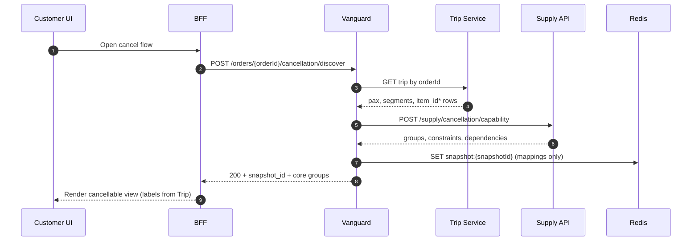

#### 1.4.2 Quote

Phase B — resolve selections from snapshot, call Supply quote, persist quote entity (§6.6), return UI quote view.

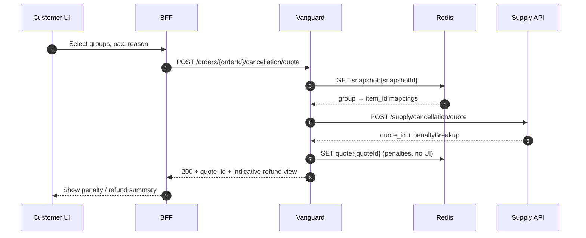

#### 1.4.3 Execute

Phase C — validate snapshot + quote, start Temporal workflow, fan-out Supply execute, return **202 PROCESSING**.

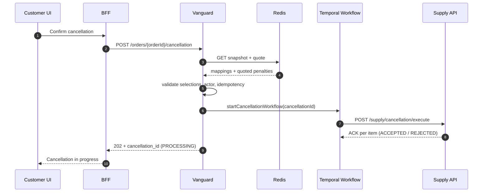

#### 1.4.4 Callback & Workflow Completion

Phase D — Supply pushes item status; workflow updates state machine; when all items terminal, triggers refund (§1.4.6).

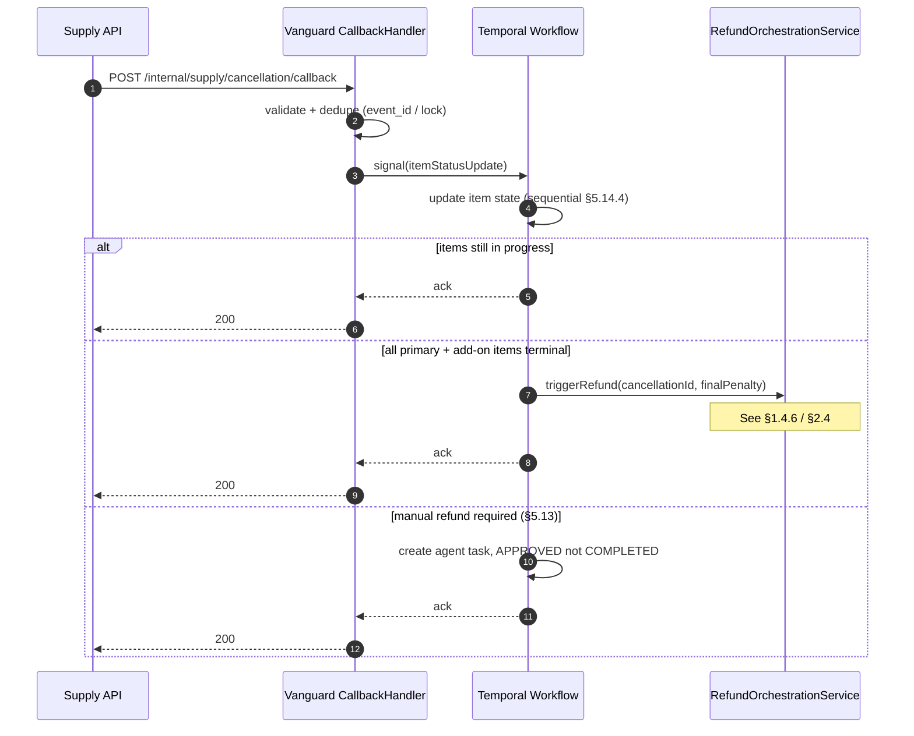

#### 1.4.5 Status Poll

Phase E — BFF polls cancellation progress while workflow runs or after completion.

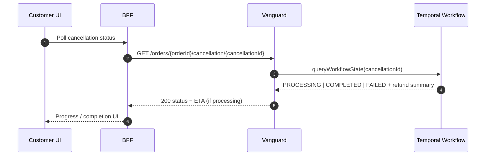

#### 1.4.6 Refund Trigger

Compact view of refund after workflow gate passes. Payment gateway and ledger steps: [§2.4](#24-mermaid--refund-sequence-primary-path).

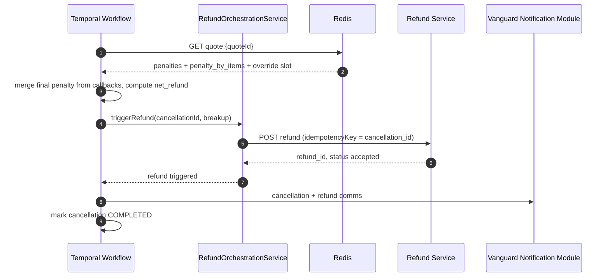

---

### 1.5 Mermaid — Discovery Internals (Component View)

Complements [§1.4.1](#141-discovery) with Vanguard internal wiring (controller → service → connector → mapper).

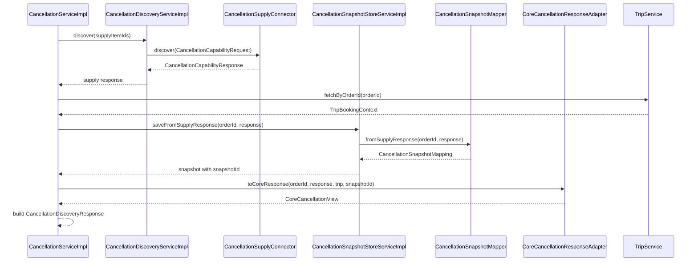

---

### 1.6 Idempotency & Failure Matrix

| Event | Key | On duplicate | On failure |
|-------|-----|--------------|------------|
| Discover | new `snapshot_id` each call | N/A (read-mostly) | 502 if Supply down |
| Quote | new `quote_id` | Re-quote if expired | 410 if snapshot gone |
| Execute | `cancellation_id` | Workflow dedup | 409 if already processing |
| Callback | `event_id` / item update | Signal dedup in workflow | Retry from Supply |
| Refund trigger | `cancellation_id` + idempotency key | Refund svc dedup | Manual queue §5.13 |

---

## 2. Post-Booking Refund Flow

### 2.1 Scope

Refund is **not fully owned** by Vanguard. Vanguard **gates and triggers** refund after cancellation completes (§2.13, §5.14, §7.8–7.9). Refund Service owns ledger and payment gateway.

### 2.2 Triggers

| Trigger | Source | When |
|---------|--------|------|
| **Workflow completion** | Temporal — all items terminal | Primary path |
| **Agent manual refund** | Agent portal task | §5.13 — unknown refund amount |
| **System-initiated cancel** | Disruption batch job | §2.17 — priority path |
| **Reconciliation cron** | Scheduled job | Missed callback / stuck workflow |

### 2.3 Functional Breakdown (Low-Level)

#### Step 1 — Refund gate (inside cancellation workflow)

1. Workflow confirms all **primary items** ∈ {COMPLETED, FAILED terminal}.
2. Workflow confirms all **dependent add-ons** terminal.
3. Workflow loads **Quote Redis** (`quote_id`) for indicative penalties.
4. Workflow merges **final penalty** from last Supply callback (`penalty_info`).
5. Apply **agent override** if present (§2.14): waiver, convenience fee refund, goodwill.
6. Compute `net_refund_amount` = aggregated item refunds − penalties + adjustments.
7. Validate: total refund ≤ total amount paid (§2.13 idempotency rule).

#### Step 2 — Refund orchestration (Vanguard → Refund Service)

1. `RefundOrchestrationService` builds refund request:
   - `cancellation_id`, `order_id`, `quote_id`, breakup by group/item.
   - Idempotency key = `cancellation_id`.
2. POST to Refund Service API.
3. Refund Service creates **ledger entry** (pending → processing).
4. Refund Service invokes **Payment Gateway** (original instrument / wallet / bank).
5. Gateway webhook → Refund Service → status update.

#### Step 3 — Post-refund

1. Refund Service callback/event → Vanguard (optional) or workflow poll.
2. Workflow marks cancellation **COMPLETED**.
3. Trigger **Notification Service** — refund initiated / completed templates.
4. Audit trail persisted: who, reason, override, breakup (§3.9).

#### Manual path (§5.13)

1. Items terminal but `refund_amount` unavailable from Supply.
2. Workflow sets cancel order = **APPROVED** (not COMPLETED).
3. Create **manual refund task** on Demand side.
4. Agent sets amount → trigger refund with same idempotency model.
5. Mark **COMPLETED** after refund confirmation.

---

### 2.4 Mermaid — Refund Sequence (Primary Path)

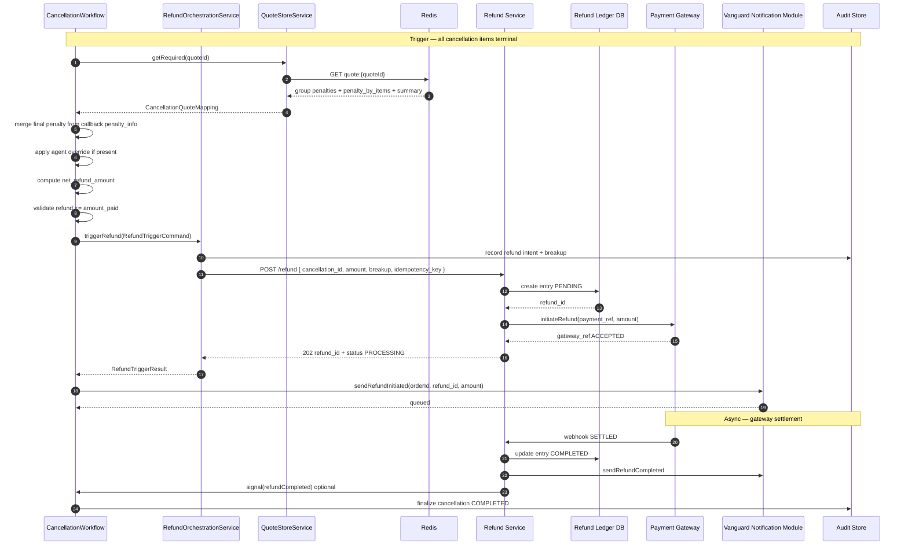

---

### 2.5 Mermaid — Manual Refund Sequence (§5.13)

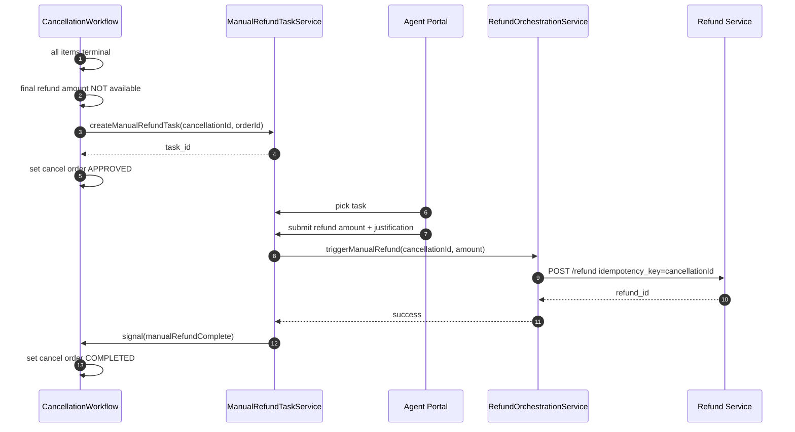

---

## 3. Complete Class Interaction Call Graph

### 3.1 Mermaid Class Diagram

```mermaid
classDiagram
    direction TB

    class CancellationController {
        -CancellationService cancellationService
        +discover(orderId, request) ResponseEntity
        +quote(orderId, request) ResponseEntity
        +execute(orderId, request) ResponseEntity
        +getStatus(orderId, cancellationId) ResponseEntity
    }

    class SupplyCallbackController {
        -CancellationWorkflowService workflowService
        +handleCallback(payload) ResponseEntity
    }

    class CancellationExceptionHandler {
        +handleSnapshotNotFound(ex) ResponseEntity
        +handleSnapshotExpired(ex) ResponseEntity
    }

    class CancellationService {
        <<interface>>
        +discover(orderId, supplyItemIds) CancellationDiscoveryResponse
        +quote(orderId, request) CancellationQuoteOutcome
        +execute(orderId, request) CancellationExecuteOutcome
        +getStatus(orderId, cancellationId) CancellationStatusOutcome
    }

    class CancellationServiceImpl {
        -CancellationDiscoveryService discoveryService
        -CancellationQuoteService quoteService
        -CancellationSnapshotStoreService snapshotStore
        -CancellationQuoteStoreService quoteStore
        -TripServiceFactory tripServiceFactory
        -CoreCancellationResponseAdapter coreAdapter
        -CancellationWorkflowService workflowService
        -RefundOrchestrationService refundOrchestrationService
    }

    class CancellationDiscoveryService {
        <<interface>>
        +discover(supplyItemIds) CancellationCapabilityResponse
    }

    class CancellationQuoteService {
        <<interface>>
        +fetchQuote(request) CancellationQuoteResponse
    }

    class CancellationWorkflowService {
        <<interface>>
        +startCancellationWorkflow(command) void
        +signalItemUpdate(cancellationId, signal) void
        +queryState(cancellationId) CancellationWorkflowState
    }

    class RefundOrchestrationService {
        <<interface>>
        +triggerRefund(command) RefundTriggerResult
        +triggerManualRefund(command) RefundTriggerResult
    }

    class CancellationSupplyConnector {
        -SupplyRestClientFactory restClientFactory
        +discover(request) CancellationCapabilityResponse
        +fetchQuote(request) CancellationQuoteResponse
        +execute(request) CancellationExecuteResponse
        +fetchStatus(cancellationId) CancellationStatusResponse
    }

    class TripServiceFactory {
        -TripServiceProperties properties
        +getActive() TripService
    }

    class TripService {
        <<interface>>
        +fetchByOrderId(orderId) TripBookingContext
    }

    class CancellationSnapshotStoreService {
        <<interface>>
        +saveFromSupplyResponse(orderId, response) CancellationSnapshotMapping
        +getRequired(snapshotId) CancellationSnapshotMapping
    }

    class CancellationQuoteStoreService {
        <<interface>>
        +saveFromSupplyResponse(orderId, snapshotId, response) CancellationQuoteMapping
        +getRequired(quoteId) CancellationQuoteMapping
    }

    class CancellationSnapshotRepository {
        <<interface>>
        +save(mapping) void
        +getRequired(snapshotId) CancellationSnapshotMapping
    }

    class CancellationQuoteRepository {
        <<interface>>
        +save(mapping) void
        +getRequired(quoteId) CancellationQuoteMapping
    }

    class RedisCancellationSnapshotRepository {
        -RedisTemplate redisTemplate
    }

    class RedisCancellationQuoteRepository {
        -RedisTemplate redisTemplate
    }

    class CoreCancellationResponseAdapter {
        -CancellationCapabilityMapper mapper
        +toCoreResponse(...) CoreCancellationView
    }

    class CancellationSnapshotMapper {
        +fromSupplyResponse(orderId, response) CancellationSnapshotMapping
    }

    class CancellationQuoteMapper {
        +fromSupplyResponse(orderId, snapshotId, response) CancellationQuoteMapping
    }

    class RefundServiceClient {
        <<interface>>
        +initiateRefund(request) RefundResponse
    }

    class NotificationClient {
        <<interface>>
        +sendCancellationCompleted(event) void
        +sendRefundInitiated(event) void
    }

    class CancellationDiscoveryResponse {
        <<record>>
        +snapshotId String
        +coreResponse CoreCancellationView
    }

    class CancellationSnapshotMapping {
        <<value>>
        +snapshotId String
        +groups List~GroupItemMapping~
    }

    class CancellationQuoteMapping {
        <<value>>
        +quoteId String
        +groups List~GroupQuoteMapping~
        +penaltyByItems List~ItemPenaltyMapping~
    }

    CancellationController --> CancellationService : uses
    SupplyCallbackController --> CancellationWorkflowService : uses
    CancellationServiceImpl ..|> CancellationService
    CancellationServiceImpl --> CancellationDiscoveryService
    CancellationServiceImpl --> CancellationQuoteService
    CancellationServiceImpl --> CancellationSnapshotStoreService
    CancellationServiceImpl --> CancellationQuoteStoreService
    CancellationServiceImpl --> TripServiceFactory
    CancellationServiceImpl --> CoreCancellationResponseAdapter
    CancellationServiceImpl --> CancellationWorkflowService
    CancellationServiceImpl --> RefundOrchestrationService

    CancellationDiscoveryServiceImpl ..|> CancellationDiscoveryService
    CancellationDiscoveryServiceImpl --> CancellationSupplyConnector

    CancellationQuoteServiceImpl ..|> CancellationQuoteService
    CancellationQuoteServiceImpl --> CancellationSupplyConnector

    CancellationSnapshotStoreServiceImpl ..|> CancellationSnapshotStoreService
    CancellationSnapshotStoreServiceImpl --> CancellationSnapshotRepository
    CancellationSnapshotStoreServiceImpl --> CancellationSnapshotMapper

    CancellationQuoteStoreServiceImpl ..|> CancellationQuoteStoreService
    CancellationQuoteStoreServiceImpl --> CancellationQuoteRepository
    CancellationQuoteStoreServiceImpl --> CancellationQuoteMapper

    RedisCancellationSnapshotRepository ..|> CancellationSnapshotRepository
    RedisCancellationQuoteRepository ..|> CancellationQuoteRepository

    TripServiceFactory --> TripService
    LegacyTripServiceImpl ..|> TripService

    CancellationWorkflowService --> CancellationSupplyConnector
    CancellationWorkflowService --> RefundOrchestrationService
    CancellationWorkflowService --> NotificationClient

    RefundOrchestrationServiceImpl ..|> RefundOrchestrationService
    RefundOrchestrationServiceImpl --> RefundServiceClient

    CancellationServiceImpl ..> CancellationDiscoveryResponse : returns
    CancellationSnapshotStoreServiceImpl ..> CancellationSnapshotMapping : persists
    CancellationQuoteStoreServiceImpl ..> CancellationQuoteMapping : persists
```

---

### 3.2 Dependency Rules (Class Level)

| From | To | Allowed |
|------|-----|---------|
| Controller | Service | Yes |
| Service | Connector, Repository, Adapter, Workflow | Yes |
| Service | Service (sub-domain) | Yes — orchestrator only |
| Connector | External HTTP | Yes |
| Repository | Redis / DB | Yes |
| Controller | Connector / Repository | **No** |
| Connector | Service | **No** |
| Repository | Controller | **No** |

---

## 4. State Machines (Reference)

### 4.1 Cancellation Item State (Workflow)

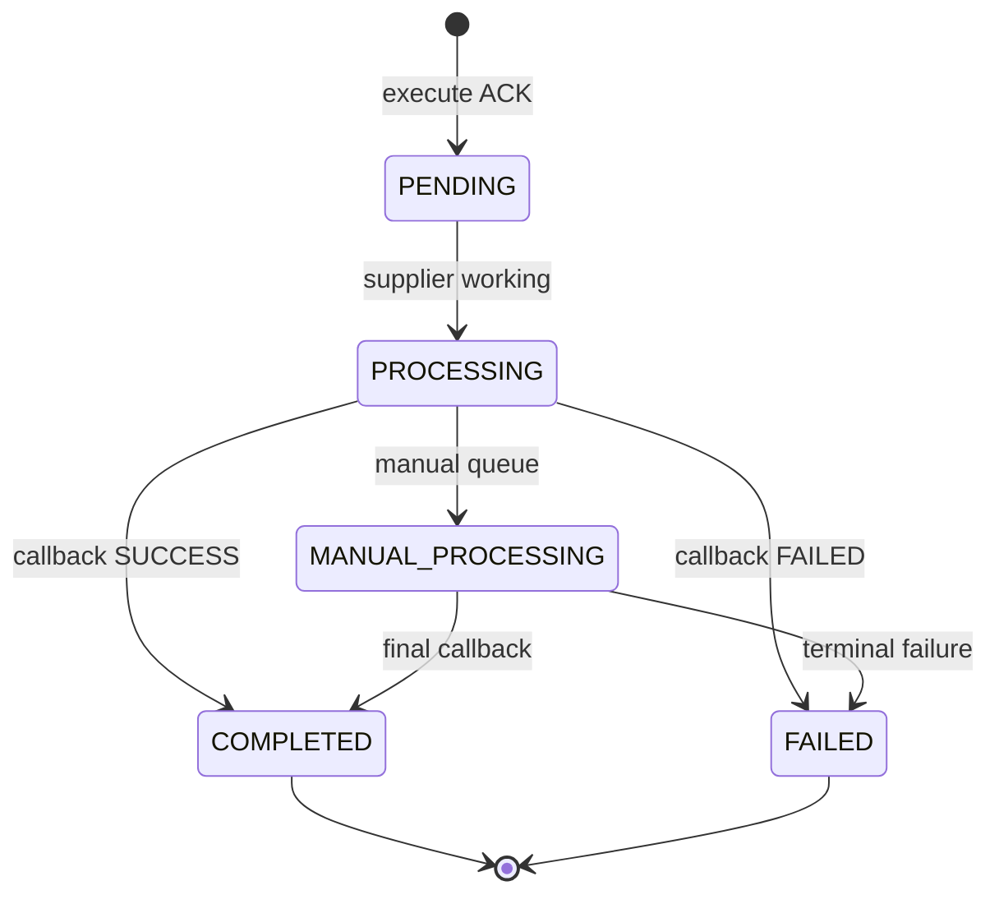

### 4.2 Order-Level Cancellation State

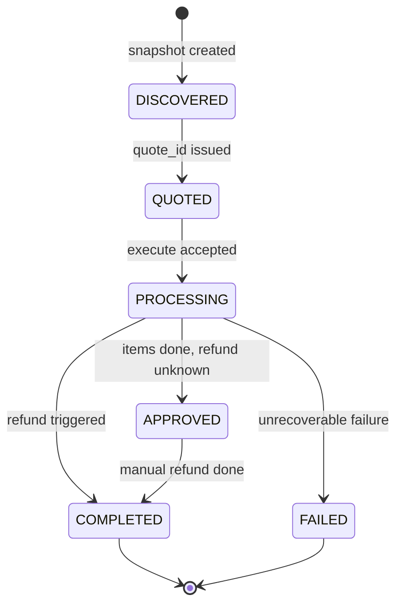

---

## 5. Data Flow Summary

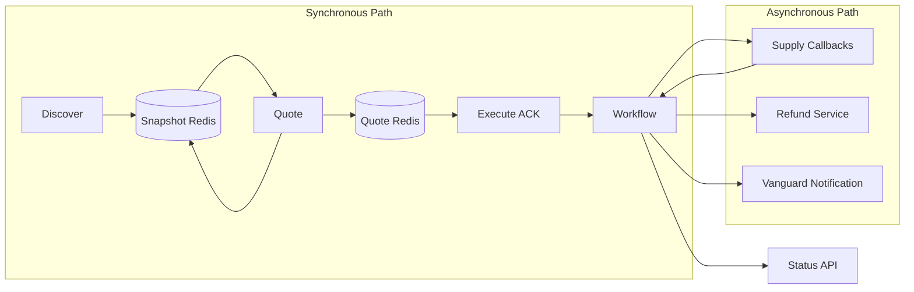

---

## 6. Contract Cross-Reference

| Step | Demand API | Supply API | Redis Entity |
|------|------------|------------|--------------|
| Discover | `POST .../discover` | `POST /supply/cancellation/capability` | §6.5 Snapshot |
| Quote | `POST .../quote` | `POST /supply/cancellation/quote` | §6.6 Quote |
| Execute | `POST .../cancellation` | `POST /supply/cancellation/execute` | — (workflow DB) |
| Callback | `POST .../callback` | Supply → Demand push | — (workflow signal) |
| Status | `GET .../{cancellationId}` | `GET /supply/cancellation/{id}` | — |
| Refund | internal | Refund Service API | — |

---

*Document 2 of 2 — System Flows & Diagrammatic Specifications. See `01-repository-setup-and-architecture.md` for module layout and bootstrap rules.*
