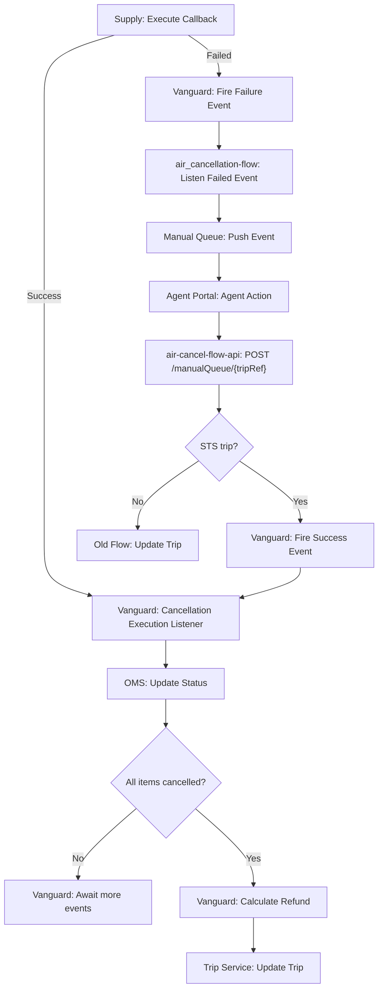

# Supply Cancellation Execute — Success / Failure Event Flow

**Service:** Vanguard — Cancellation Execution Listener  
**Scope:** STS + OMS trips flowing through Vanguard

---

## 1. Overview

Supply publishes execute **success** or **failed** callbacks. **Vanguard** handles the success path via the Cancellation Execution Listener. On failure, **Vanguard** fires a failure event; **air_cancellation-flow** listens, pushes to **Manual Queue**, and agent resolves via **air-cancel-flow-api**.

### Summary

**On success (Supply callback)**
- Vanguard Cancellation Execution Listener receives the event
- Update OMS — mark item(s) cancelled
- If not all items cancelled → wait for more Supply events
- If all items cancelled → calculate refund → update Trip Service

**On failure (Supply callback)**
- Vanguard fires failure event
- air_cancellation-flow listens and pushes event to Manual Queue
- Agent picks order from Manual Queue

**Agent action**
- Agent calls `POST /manualQueue/{tripRef}` on air-cancel-flow-api
- **STS trip** → Vanguard fires success event → resumes success listener path (OMS → refund → Trip)
- **Non-STS trip** → old flow to update trip (legacy path, skips Vanguard listener)

**Key rules**
- Refund only after **all items** are cancelled
- Vanguard owns STS + OMS trip cancellation; non-STS stays on legacy flow
- Manual Queue is the handoff between async failure and agent resolution

---

## 2. Actors

| Service | Role |
|---------|------|
| **Supply** | Executes cancellation; publishes success/failed execute callback |
| **Vanguard** | Success listener; fires failure event on failed callback |
| **OMS** | Item cancellation status updated by Vanguard |
| **Trip Service** | Updated after refund calculated (STS path) or via old flow (non-STS) |
| **air_cancellation-flow** | Listens to Vanguard failure event; pushes to Manual Queue |
| **air-cancel-flow-api** | Agent manual-queue handler; STS trip decision |
| **Agent Portal** | Agent action on orders in Manual Queue |

---

## 3. Success Path

**Trigger:** Supply execute callback — **Success**

1. **Vanguard: Cancellation Execution Listener** receives event
2. **OMS: Update status** — mark item(s) cancelled
3. **All items cancelled?** (decision)
   - No → **Vanguard: Await more events**
   - Yes → **Vanguard: Calculate refund** → **Trip Service: Update trip**

---

## 4. Failure Path

**Trigger:** Supply execute callback — **Failed**

1. **Vanguard: Fire failure event**
2. **air_cancellation-flow: Listen failed event**
3. **Manual Queue: Push event**

### 4.1 Agent Action (Manual Queue)

Agent picks order from Manual Queue and triggers:

```
POST /manualQueue/{tripRef}    (air-cancel-flow-api)
```

**Processing at air-cancel-flow-api:**

1. Load trip context for `tripRef`
2. **STS trip?** (decision)
   - **Yes** → **Vanguard: Fire success event** → Cancellation Execution Listener resumes success path (OMS → all items check → refund → Trip)
   - **No** → **Old flow: Update trip** (legacy cancel/refund path; does not go through Vanguard listener)

---

## 5. Flow Diagram



### ASCII

```
                    Supply: Execute Callback
                              │
                 ┌────────────┴────────────┐
                 │                         │
              Success                    Failed
                 │                         │
                 │                         ▼
                 │              Vanguard: Fire Failure Event
                 │                         │
                 │                         ▼
                 │         air_cancellation-flow: Listen Failed Event
                 │                         │
                 │                         ▼
                 │              Manual Queue: Push Event
                 │                         │
                 │                         ▼
                 │              Agent Portal: Agent Action
                 │                         │
                 │                         ▼
                 │         air-cancel-flow-api: POST /manualQueue/{tripRef}
                 │                         │
                 │                    ◇ STS trip? ◇
                 │                    /            \
                 │                 Yes              No
                 │                  │                │
                 │                  ▼                ▼
                 │    Vanguard: Fire Success Event  Old Flow: Update Trip
                 │                  │
                 └──────────────────┘
                                    │
                                    ▼
              Vanguard: Cancellation Execution Listener
                                    │
                                    ▼
                        OMS: Update Status
                                    │
                          ◇ All items cancelled? ◇
                          /                      \
                        No                      Yes
                         │                        │
                         ▼                        ▼
            Vanguard: Await more events    Vanguard: Calculate Refund
                                                  │
                                                  ▼
                                      Trip Service: Update Trip
```

---

## 6. Notes

- Every box = a **service** (or decision diamond)
- Failure event is **published by Vanguard**; air_cancellation-flow **listens**
- Failed orders go to **Manual Queue**
- Agent calls **`POST /manualQueue/{tripRef}`** on **air-cancel-flow-api**
- **STS trip** → fire success event → Vanguard listener path (OMS, refund, Trip)
- **Non-STS trip** → old flow to update trip (legacy path, no Vanguard listener)
- Refund only when **all items** cancelled (second decision diamond)
